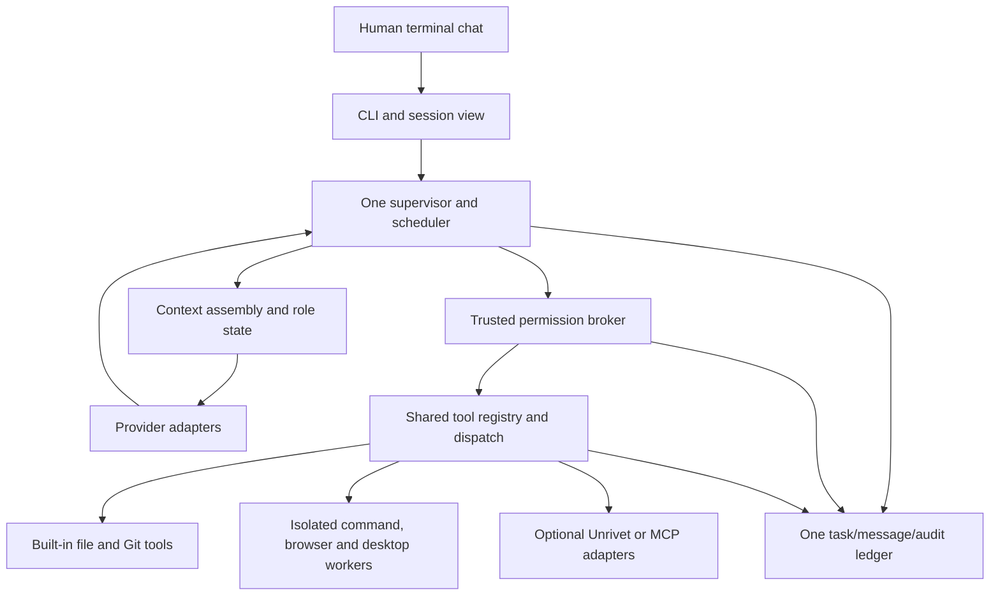

# Proposed Rivet architecture

**Current authority update (post-P3):** P1–P3 bounded profiles are implemented; [fresh verification](research/post-p3-verification.md) is partial because native host checks were not rerun. P0 statements below about absent implementation/authorization are historical. The [post-P3 brief](POST_P3_RESEARCH_BRIEF.md) supersedes older exclusions of hybrid dashboard/global coordination, approves workspace model C and recipe-first export, and defines official-mod/resource/memory/recovery research boundaries. See [current handoff](POST_P3_HANDOFF.md) and [decisions](open-decisions.md). No P4+ implementation or license adoption is authorized by these plans.

**P0.6 authority note:** The [master implementation plan](MASTER_IMPLEMENTATION_PLAN.md) selects the current stack, defaults and contracts; [decision dispositions](open-decisions.md) distinguish owner approvals from technical recommendations. P0.5 comparisons and proposal wording below are retained as research provenance, not competing current defaults. No implementation is authorized.

**P0.5 research; no implementation.** Approved constraints come from the [brief](RIVET_PROJECT_BRIEF.md). All component contracts, storage shapes and technology choices below are proposals for later approval. Upstream facts are linked; source IDs resolve through the [source register](research/source-register.md). Scheduling is authoritative in [agent execution](agent-execution.md); failure/replay policy is authoritative in [security and recovery](security-and-recovery.md).

## Architectural direction

Recommend a Rust terminal application with a small composition root, one supervisor, a trusted permission broker, a shared registry, provider adapters and one local SQLite ledger. Prefer library boundaries inside one application over microservices. Tokio supplies execution primitives, not Rivet's durable workflow semantics. [Tokio API, S01](https://docs.rs/tokio/latest/tokio/)

Arrows show logical calls, not separate daemons. No provider response or extension callback may skip broker validation. Ledger writes should be exposed through one service boundary rather than handed to workers as a database handle. SQLite is still the principal candidate, not an approved final schema.

## Components and ownership

| Component | Owns | Must not own |
| --- | --- | --- |
| CLI/session view | Input, output, approvals, pause/stop, model-free administrative commands | Hidden policy grants, direct agent tool execution, a second message store |
| Supervisor | Run lifecycle, validated hierarchy, scheduling, budgets, completion evidence | Provider-specific JSON, arbitrary shell string construction |
| Agent state/context assembler | Role/task context, provenance, tool-result references, compaction | New grants, unbounded transcripts, automatic cross-project retrieval |
| Provider layer | Capability discovery, request normalization, streaming, usage and errors | Tool dispatch, user consent, automatic cloud fallback/model acquisition |
| Permission broker | Policy evaluation, approval binding, revocation and execution grants | Model-generated approval interpretation, independent background service per feature |
| Tool registry/dispatcher | Immutable versioned descriptors, argument validation, adapter resolution and receipts | Assuming installed means allowed; dynamic widening of grants |
| Ledger service | Transactional state transitions, messages, audit, checkpoints and migrations | Storing plaintext credentials or claiming atomicity for external effects |
| Worker manager | Process launch, isolation, output quotas, deadlines, termination/reaping | Direct unrestricted host credentials, access to ledger or permission-signing state |
| Capability/asset manager | Verified tool identities, selected preset and location, immutable asset references | Unapproved downloads, mutable shared executables in use |
| Cookbook | Recommendations from qualified fit data and hierarchy budgets | A second scheduler, auto-benchmarks, compulsory models |

Use bounded queues and backpressure at provider, ledger and worker boundaries. Keep UI response independent of slow database or process output. A diagnostic sink may use tracing, but essential authorization/task transitions must be recorded transactionally rather than relying on best-effort diagnostic logs. [tracing, S09](https://docs.rs/crate/tracing/latest)

## Candidate interfaces

These are conceptual message contracts, not Rust source, public APIs or final schemas.

| Interface | Input | Output and required invariants |
| --- | --- | --- |
| Run request | Project/session ID, user task, hierarchy configuration, permission/budget snapshot | Run ID, accepted configuration or explicit validation failure; no inference during model-free setup |
| Provider request | Provider/model identity, typed messages, allowed tool schemas, output ceiling, cancellation handle | Ordered text/tool-call/usage/error events; tool JSON is data until independently validated |
| Tool proposal | Run/task/agent IDs, tool/version, normalized arguments, workspace revision and intended effects | Allow, deny, or human approval request with exact scope; every proposal gets a correlation ID |
| Execution grant | Broker-issued operation ID, permitted resources/effects, policy epoch, expiry, argument digest | Worker can use only granted capabilities; stale grants rejected before dispatch |
| Tool receipt | Operation/attempt ID, exit/result class, artifacts, observed effects, integrity metadata | Durable outcome or explicit unknown; bounded redacted output with provenance |
| Ledger transition | Expected current state/revision, owner fencing token, event and data | One atomic transition and audit entry, or conflict/failure; no silent last-writer-wins |
| Message delivery | Sender/recipient/task, sequence, body/artifact references, user-decision provenance | Durable delivery/acknowledgment state; duplicate delivery must not duplicate work |
| Session export | Authorized selection and redaction policy | Markdown/JSON with version and provenance; no credential values |

The broker should check semantic operations first, then produce OS/process restrictions. Raw commands are a separate broad execution capability. Parsing a shell string is not a reliable substitute for restricting the resulting process tree.

## Provider boundary and compatibility

Recommend a narrow Rivet-owned provider interface and compare Rig's provider layer against direct HTTP adapters before choosing either. Rig offers reusable provider/message abstractions, but moving main also has separate agent/memory/effect components; adopting all of them could duplicate Rivet's supervisor and ledger. [Rig, S17](https://github.com/0xPlaygrounds/rig)

Maintain a per-provider capability record: endpoint type, model ID/version, tool schema support, parallel tool calls, structured output, context limit, streaming protocol, usage accounting, cancellation semantics and retry classification. “OpenAI-compatible” should be a tested profile, not an assertion of identical APIs. llama.cpp documents slots and model/template-dependent tool calling; Ollama documents local and cloud surfaces. [llama.cpp, S23](https://github.com/ggml-org/llama.cpp/blob/master/tools/server/README.md), [Ollama, S24](https://docs.ollama.com/api/introduction)

Do not replay incomplete tool-call fragments. Assemble and validate a complete call before permission evaluation. A transport EOF does not imply the server did no work. Preserve request IDs and usage uncertainty without logging secrets. Specific provider API versions must be pinned: the Anthropic overview requires a version header and has provider-specific authentication. [Anthropic, S25](https://platform.claude.com/docs/en/api/overview)

No provider configured is a legitimate administrative state. Health checks should distinguish static configuration validation from an explicitly permitted inference check. No model/provider/library example defaults may override Rivet's no-download/no-paid-call policy.

## Ledger and sessions

Recommend one local ledger per project under application-managed project state, with supervisor exclusivity for that ledger. Multiple project instances can each have a ledger; “one ledger” means no parallel task/message/audit database for the same project. Exact physical placement and cross-project metadata require approval (D03). Keep operational state outside the source tree by default only once a future user-authorized location policy exists; this research stage creates no such runtime directory.

Proposed logical records:

| Record family | Necessary contents |
| --- | --- |
| Project/session/run | Workspace identity, root capability, config version, selected provider policy, lifecycle and parent links |
| Tasks/agents/assignments | Dependency graph, role composition, exclusive owner, lease/fencing epoch, artifact/revision preconditions |
| Events/audit | Ordered event IDs, actor, policy version, operation/decision correlation, timestamps and redacted evidence |
| Operations/attempts | Stable operation ID, attempt count, effect class, intent, dispatch status, receipt and reconciliation state |
| Messages/acknowledgments | Per-recipient delivery sequence, references, acknowledgments, deduplication key and routing history |
| Grants/budgets | Scope, expiry/revocation epoch, authorized provider/destination, reservations and reconciled usage |
| Checkpoints/artifacts | Schema version, cursor, content hashes, summaries, source references and artifact integrity state |

Avoid storing every streamed token as a separate synchronous transaction; batch low-risk display events while committing approval, dispatch intent and final receipts at defined safety boundaries. Never delay a required authorization record just to improve throughput.

Prefer rusqlite with a dedicated ledger worker/thread and bounded messages for a SQLite-only application; compare SQLx if async pooling/query tooling materially reduces complexity. Both are existing solutions. Do not hold a write transaction across an inference call or tool process. [rusqlite, S04](https://docs.rs/rusqlite/latest/rusqlite/), [SQLx, S05](https://docs.rs/crate/sqlx/latest)

WAL supports concurrent readers but still one writer, and needs local shared-memory assumptions. Bound busy retries, enforce foreign keys/constraints per connection, choose a documented synchronous policy, and manage WAL checkpoints. Validate an engine containing the WAL-reset fix; a wrapper version alone is insufficient. [SQLite WAL, S27](https://www.sqlite.org/wal.html)

Use forward-only, versioned migrations with a verified backup and compatibility check. Reject a newer unknown schema. Use a consistent backup API rather than copying only a live database file. Recovery and artifact transaction gaps are detailed separately. [SQLite backup, S28](https://www.sqlite.org/backup.html)

A session is conversation/context history; a run is an authorized execution attempt; a task is a unit with ownership and completion evidence. Resuming a session must not automatically renew a run's expired grants or budgets. Forking a session should preserve provenance while creating new operation IDs and requiring an explicit execution request.

## Unrivet extension API proposal

Rivet owns the runtime; Unrivet is an optional client of stable capability contracts. Its presence must not alter Minimal or auto-enable reverse engineering. New-project opt-in remains exactly the brief's editable Yes/No decision. No Unrivet repository was inspected.

Prefer a versioned, process-isolated JSON-RPC control boundary with a small manifest and negotiated capabilities. Reuse rmcp for MCP tool transport where it fits; MCP alone does not define installation, permissions, evidence provenance or Rivet's extension lifecycle. Avoid native Rust dynamic-library ABI as the initial third-party boundary. [MCP Rust SDK, S21](https://github.com/modelcontextprotocol/rust-sdk)

Proposed extension manifest/handshake fields: extension ID, protocol range, build/tool identities, tool schemas, declared effects, required capabilities, supported platform, evidence format, license/notice references and cancellation/recovery support. Reject duplicate tool IDs and incompatible major versions before activation. Namespaced tool IDs prevent shadowing built-ins.

Proposed lifecycle:

1. Discover only explicitly configured/verified manifests; inspecting an untrusted project must not auto-execute its plugins.
2. Validate manifest and API range, then ask project enablement if applicable.
3. Register descriptors in the same registry; all qualified Rivet tools remain available under existing permissions.
4. Resolve each call through the broker, scoped worker and common ledger. Extensions cannot self-grant device/network access or create agent roles outside mode rules.
5. Collect evidence receipts and preserve original bytes; extension-specific evidence is an artifact type, not another task ledger.
6. On disable/uninstall, stop new dispatch, cancel/drain active calls, keep audit/evidence and mark unavailable tasks. Ordinary Rivet tasks remain runnable.

Require bounded payloads, request IDs, capability revocation, EOF/restart handling, handshake timeout and malformed-response tests. stdio avoids a new listening service; remote MCP requires explicit endpoint/auth policy. Device analysis may warrant a distinct worker privilege boundary, not a duplicate hierarchy engine.

## Failure handling and feasibility limits

| Failure | Proposed response |
| --- | --- |
| Provider quota/timeout | Bounded retry only where effect-safe; preserve ambiguity and pause on budget/credential failure; no hidden fallback |
| Worker crash | Record exit or unknown; reconcile intended effects before retry; quarantine repeated malformed responses |
| Ledger unavailable/disk full | Stop new side effects, surface failure and preserve available receipts; never continue “without audit” |
| Supervisor crash | Restart under exclusive lock; validate ledger/artifacts, fence old owners and reconcile in-flight operations |
| Human edits workspace | Invalidate stale patch/task preconditions; present conflict; never overwrite edits automatically |
| Permission revoked | Block new dispatch, propagate cancellation, reconcile in-flight effects and report irreversible ones |
| Extension incompatibility | Disable affected extension, preserve evidence, leave standalone Rivet operational |

Single-host multi-agent execution is feasible in principle with these building blocks; demonstrated reliability, terminal interaction, performance and sandbox compatibility remain untested. Mesh here means local peer coordination unless a separately approved distributed design is chosen; the approved mode name does not require a network cluster. No distributed database, service mesh or permanent daemon is justified at this stage.
